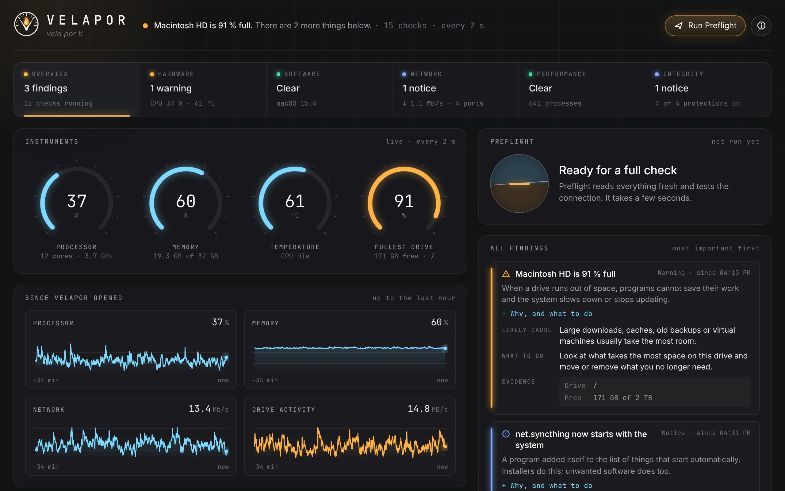

<p align="center">
  
</p>

<h1 align="center">Velapor</h1>

<p align="center">
  <strong>Your machine, watched over.</strong><br>
  A calm cockpit for your computer. Velapor reads your hardware, network, system and
  performance, and tells you in plain words when something needs your attention.
  It only ever looks. It never touches.
</p>

<p align="center">
  <a href="../../releases/latest">Download</a> ·
  <a href="https://velapor.app">Website</a> ·
  <a href="docs/DEVELOPMENT.md">Build from source</a>
</p>

<p align="center">
  
  
  
  
</p>



---

## What it does

Velapor keeps watch from the moment it opens. Every two seconds it takes a fresh reading of the
machine, runs it past a set of rules, and shows what it found. While everything is fine you see
calm gauges. When something drifts, a finding appears with the evidence it is based on and what
you can do about it.

| Tab | What it watches |
|---|---|
| **Overview** | Gauges for processor, memory, disk and temperature, every open finding, and the state of each area |
| **Hardware** | The full machine: processor, memory, drives, sensors, battery, and everything attached to it (USB devices, adapters, displays, power) |
| **Software** | The operating system, how long it has been running, and what starts with it |
| **Network** | A speed test, live traffic, open ports and who opened them, interfaces and the busiest connections |
| **Performance** | Load over time, memory pressure, swap, and the hungriest processes |
| **Integrity** | Security settings (firewall, disk encryption, system protection) and the things that should stay still since Velapor opened |

**Preflight.** Pilots walk around the aircraft before every flight. One click runs every check
at once, including whether names resolve and the internet answers, and gives one readable
report.

## How it speaks

| | Severity | Meaning |
|:---:|---|---|
| 🟢 | Clear | Nothing to see here |
| 🔵 | Notice | Worth knowing, nothing to do yet |
| 🟠 | Warning | Look at it soon |
| 🔴 | Critical | Look at it now |

Warnings and critical findings also arrive as a notification, at most a few at a time. Routine
things stay in the window.

## Read-only, by design

Velapor observes and warns. That is all it does.

- **It never writes.** No settings are changed, no process is stopped, no file is created,
  moved or deleted. A test in `core/tests/read_only.rs` checks the source for write calls on
  every build.
- **It only asks.** A few facts are only known to the system's own reporting tools (for example
  whether FileVault or the Windows firewall is on). Those tools are on a fixed list in
  `core/src/system_query.rs`, with fixed arguments.
- **It remembers nothing.** What Velapor compares against (startup items, open ports, devices,
  the hosts file) is captured when it opens and kept in memory only.
- **It stays on your machine.** No account, no cloud, no telemetry. The only network traffic is
  the speed test you start yourself (against Cloudflare) and the two small connection checks in
  Preflight.

## Install

Download the latest version for your system from the [**Releases**](../../releases/latest) page:

| System | File |
|---|---|
| macOS (Apple Silicon) | `Velapor-macOS-Apple-Silicon.dmg` |
| macOS (Intel) | `Velapor-macOS-Intel.dmg` |
| Windows | `Velapor-Windows-Setup.exe` or `Velapor-Windows.msi` |
| Linux | `Velapor-Linux.AppImage` (any distribution), `.deb` (Debian, Ubuntu) or `.rpm` (Fedora, openSUSE) |

> **First start:** the Windows installers aren't signed yet: choose **More info → Run anyway**
> if SmartScreen asks. On Linux, the tray icon needs AppIndicator support (on GNOME: the
> "AppIndicator" extension).

## Build from source

Velapor is written in Rust with [Tauri](https://tauri.app). The interface is plain HTML, CSS and
JavaScript, with no Node.js needed.

```sh
cargo install tauri-cli --version "^2" --locked
cargo tauri dev       # run it
cargo tauri build     # make installers for your system
```

See [**docs/DEVELOPMENT.md**](docs/DEVELOPMENT.md) for requirements per system and the project
layout, and [**docs/ARCHITECTURE.md**](docs/ARCHITECTURE.md) for how a reading becomes a finding.

## The name

*Velar por* is Spanish and Portuguese for "to watch over". *Vela por ti* means "it watches over
you". A *vela* is also a candle: a small light that keeps burning through the night.

## Contributing

Bug reports, ideas and pull requests are welcome. See [CONTRIBUTING.md](CONTRIBUTING.md), and
please open an issue first for bigger changes.

## Licence

[MIT](LICENSE) © 2026 [stean.ART](https://stean.art)
